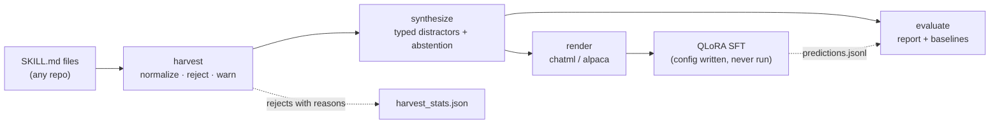

<div align="center">

<h1>SkillForge</h1>

<p><strong>
Turn the open agent-skill ecosystem into supervised fine-tuning data — and measure whether a small model can actually use it.
</strong></p>

<p><em>Every task, plan and check is mined from the skill's own text. Nothing is invented — a dataset you have to caveat is a dataset nobody can build on.</em></p>

<p>


</p>

<p>
<a href="docs/DESIGN.md">📐 Design</a> ·
<a href="docs/BENCHMARK.md">🧪 Benchmark</a> ·
<a href="docs/LICENSING.md">⚖️ Licensing</a> ·
<a href="docs/RELATED_WORK.md">📚 Related work</a>
</p>

</div>

---

## The gap

Agent skills — a `SKILL.md` with a `description` that decides when it fires and a body
disclosed only after it is chosen — went from a convention to an ecosystem in 2026.
Thousands are published. Three things are still missing:

1. **Skill use is never a training target.** Skills are prompt-engineered *around*
   models, not trained *into* them. Every published benchmark evaluates frontier
   models zero-shot.
2. **Selection is evaluated without abstention.** The dominant real-world failure is
   over-triggering — firing a skill that does not fit. A menu where something always
   fits cannot see that failure at all.
3. **Wrong answers are untyped.** "72% accuracy" hides whether the model loses to a
   near-duplicate skill or to an unrelated one. Those are different bugs.

SkillForge is a pipeline for all three: harvest real skills, mine grounded
trajectories from them, and score selection with typed distractors and abstention
items — on CPU, with no dependencies.

## Pipeline



## Three ideas worth stealing

**Grounded, not generated.** Tasks come from the skill's own trigger phrases; plans
come from its stated steps; checks come from its stated success criteria. A skill
that states none of these yields fewer rows — never fabricated ones. No LLM is
required anywhere in the pipeline, so the corpus is reproducible byte-for-byte from
a seed.

**Typed distractors.** Every wrong option is labelled `lexical` (nearest neighbour by
description similarity), `same_source`, `random`, or `unrelated`. The report breaks
confusion down by type, which turns a score into a diagnosis.

**Holdout by skill, not by row.** Dev skills never appear in train. The question worth
answering is whether a model generalizes to skills it has never seen; a row-level
split answers a much easier question while looking identical on a scoreboard.

## Quickstart

No GPU, no install, no network:

```bash
git clone <your-fork> && cd skillforge
make all            # harvest → synthesize → render → evaluate, on the bundled fixtures
make test           # 30 tests
```

Point it at a real skill library:

```bash
skillforge harvest    --input path/to/skills --source anthropic-skills \
                      --out data/corpus/skills.jsonl
skillforge synthesize --corpus data/corpus/skills.jsonl --distractors 12 \
                      --abstain-rate 0.25 --seed 20260807
skillforge render     --trajectories data/trajectories/train.jsonl --format chatml
skillforge baselines  --trajectories data/trajectories/dev.jsonl
```

Score your own model by writing `{"trajectory_id": ..., "prediction": ...}` per line:

```bash
skillforge evaluate --trajectories data/trajectories/dev.jsonl \
                    --predictions my_model_preds.jsonl --report data/reports/mine.json
```

## What the report tells you

| Field | Why it is there |
|:--|:--|
| `answerable.accuracy` | Selection accuracy where a skill genuinely fits |
| `abstention.recall` | Did it say `NONE` when nothing fit |
| `abstention.false_invocation_rate` | Over-triggering — the failure that breaks real skill libraries |
| `confusion_by_distractor_kind` | Whether it loses to near-duplicates or to noise |
| `position_bias` | Accuracy by the gold option's index; a gradient means it is reading order, not descriptions |
| `plan_coverage_mean` | For `invoke` items, how much of the skill's stated procedure survived |
| `parse_failures`, `off_menu_predictions` | Formatting and hallucinated skill names, counted separately from wrong choices |

Undefined rates report `null`, never `0.0` — a rate over zero items is not a failure,
and pretending otherwise poisons any average taken across splits.

## Baselines on the bundled fixtures

10 skills, 113 trajectories, 6 distractors, seed `20260807`. These are the
*trivial* baselines — they exist to bound the task, not to be beaten.

| baseline | overall | answerable | abstain recall | false invocation |
|:--|--:|--:|--:|--:|
| `oracle` | 1.000 | 1.000 | 1.000 | 0.000 |
| `always_abstain` | 0.087 | 0.000 | 1.000 | 0.000 |
| `first` | 0.065 | 0.071 | 0.000 | 1.000 |
| `lexical` | **0.837** | 0.821 | 1.000 | 0.000 |

**Read the lexical row as a warning, not a result.** A bag-of-words matcher scoring
0.837 means that at ten hand-written skills this benchmark is mostly a string-matching
test. That is a property of the fixture corpus, not of the method — the fixtures exist
to exercise the pipeline, and the number is published here so nobody mistakes them for
a benchmark. Harvesting a real corpus of several hundred overlapping skills is what
makes the lexical floor drop, and it is the next task.

`oracle` scoring anything other than 1.000 raises rather than reports: if the scorer
disagrees with its own labels, every other number in the file is untrustworthy.

## Layout

| Path | Purpose |
|:--|:--|
| `src/skillforge/harvest.py` | SKILL.md → normalized corpus, with typed rejects |
| `src/skillforge/mine.py` | Trigger phrases, steps and criteria — mined, never invented |
| `src/skillforge/synthesize.py` | Trajectories, typed distractors, abstention, skill-level holdout |
| `src/skillforge/render.py` | The single source of truth for the prompt (train == eval) |
| `src/skillforge/evaluate.py` | Scoring, trivial baselines, validity checks |
| `src/skillforge/frontmatter.py` | A tiny YAML reader that raises rather than guesses |
| `configs/qlora_4b.yaml` | QLoRA SFT config — **never run**, see Status |
| `scripts/train/launch.sh` | Refuses placeholders, nulls, missing data, and missing GPUs |
| `fixtures/skills/` | 10 realistic skills + 2 deliberately malformed ones |

## Status

Scaffold. The data pipeline is complete and tested; **no training has run** — there is
no GPU in the development environment, and a config that has never been executed is
not a validated recipe.

- [x] Harvest, synthesize, render, evaluate — end to end on CPU, zero dependencies
- [x] 30 tests, `ruff` clean
- [x] Trivial baselines + oracle self-check
- [ ] Harvest a real multi-source corpus (several hundred skills)
- [ ] Zero-shot report for an off-the-shelf small model, as the pre-training reference
- [ ] QLoRA run, then the same report post-training
- [ ] Non-English skill descriptions — selection across languages is untested

### Known issues

Found by running the pipeline, all open.

| Issue | Impact |
|:--|:--|
| At fixture scale the skill-level holdout can yield a dev split with **zero abstention items** | `abstention.*` reports `null` on dev; the abstention metric is unmeasurable until the corpus is larger |
| `distractor_kind_counts` shows no `random` on the fixtures | All 10 fixtures share one source, so `same_source` absorbs the budget before `random` is reached — the type breakdown only becomes informative on a multi-source corpus |
| `plan_coverage` is prefix-match, not semantic | A correctly paraphrased step scores as a miss; it is a floor on plan quality, not a measurement of it |
| The `lexical` baseline doubles as the hard-negative sampler | Distractors are chosen by the same similarity the baseline uses, which likely *understates* how much the benchmark favours string matching |

## License

[Apache License 2.0](LICENSE) — Copyright 2026 MKD Co., Ltd.

This covers this repository's code and the bundled fixture skills. It does **not**
extend to skills you harvest: every upstream skill carries its own license, the
harvester records it, and a missing `license:` field is recorded as a warning rather
than assumed permissive. See [docs/LICENSING.md](docs/LICENSING.md) before
redistributing a harvested corpus.
