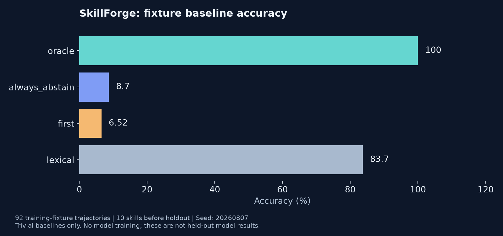

# Reproduce fixture baselines

From the repository root, using Python 3.10 or newer:

```bash
python examples/quickstart.py
```

No installation, GPU, network, or model is needed. The script runs harvesting, synthesis, ChatML rendering, and baseline scoring against the bundled skills.

## Actual fixture output

- 10 accepted skills and 2 deliberately malformed rejected fixtures.
- 113 trajectories: 92 train and 21 dev, held out by skill.
- 92 rendered training rows.
- Reports written under `examples/generated/reports`.



| Baseline | Accuracy on training fixtures |
| :--- | ---: |
| Oracle | 100.0% |
| Always abstain | 8.7% |
| First option | 6.5% |
| Lexical | 83.7% |

These are trivial baselines on a tiny fixture corpus, not held-out model results. The lexical result illustrates that the current fixtures favor string matching. No fine-tuning has run. See [benchmark design](../docs/BENCHMARK.md) and the main README's limitations.
